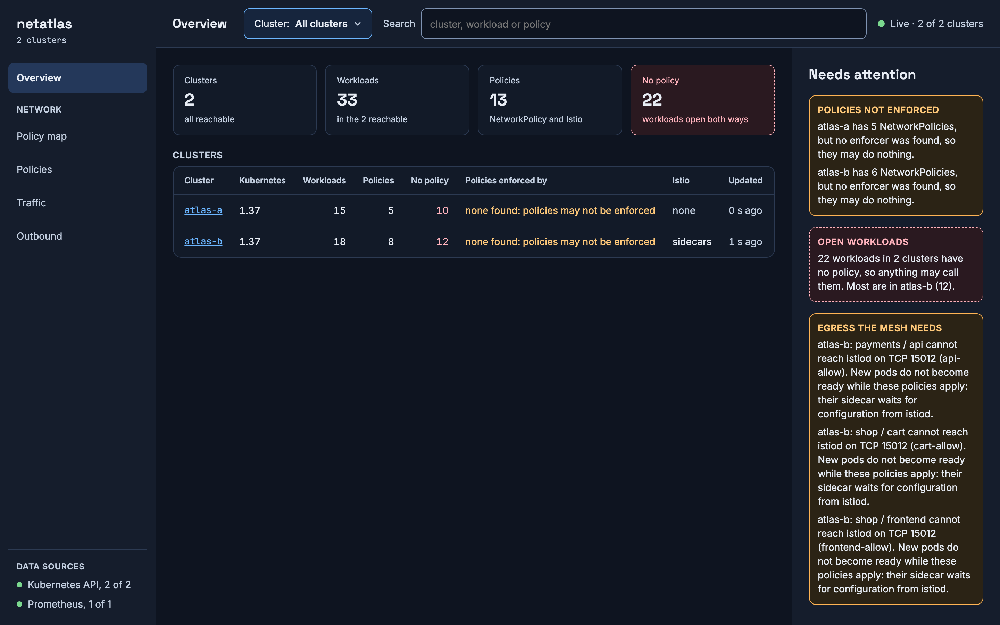
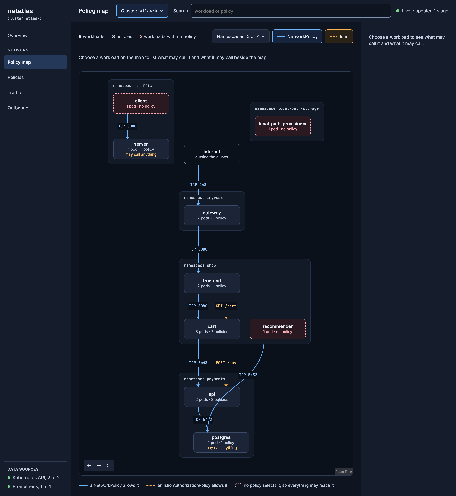
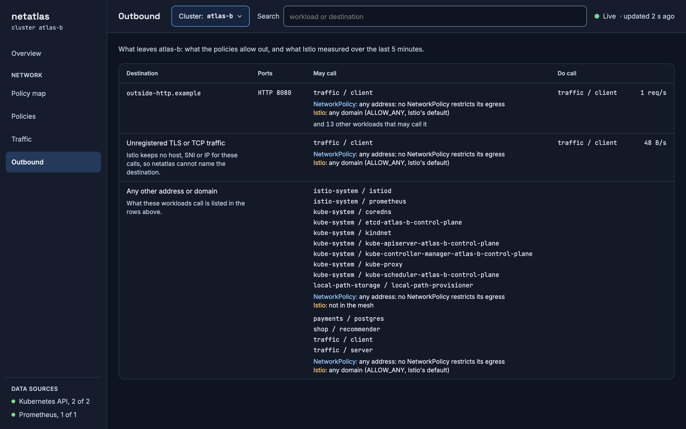

# netatlas

[](https://github.com/kitecorp/netatlas/actions/workflows/ci.yml?query=branch%3Amaster)
[](https://github.com/kitecorp/netatlas/releases)
[](LICENSE)
[](https://artifacthub.io/packages/search?repo=netatlas)

netatlas shows the NetworkPolicies and Istio AuthorizationPolicies of every Kubernetes cluster you run from one place, and compares them with the traffic Istio records. It edits a NetworkPolicy as a draft in your browser, which ends in Copy YAML for git or in Apply with your own token.


Traffic: the calls Istio measured in the last 5 minutes, each marked against the policies.



Overview: every cluster in one table, and what needs attention in each.



Policy map: which workload may call which, by NetworkPolicy and by Istio.



Outbound: each destination outside the cluster, who may call it and who does.

## What 0.2.0 does

0.2.1 is the same application as 0.2.0; it adds the chart's README and its Artifact Hub details.

- **Overview**: a row per cluster with its Kubernetes version, workloads, policies, workloads no policy selects (a workload that only DENY or CUSTOM AuthorizationPolicies select counts as having a policy, though Istio lets in every request those policies do not refuse: [what 0.2.0 leaves out](docs/todo.md)), the enforcer it found and its Istio mode, and a list of what needs attention. The list warns when an egress NetworkPolicy keeps a workload from istiod, so new pods do not become ready, or from the cluster's DNS, so names do not resolve.
- **Policy map**: one cluster's workloads by namespace, the Internet as one node, and a line for each call a NetworkPolicy or an Istio AuthorizationPolicy allows. A workload no policy selects is marked open. The map and the workload panel draw each layer's own lines, so an Istio line can be drawn for a pair a NetworkPolicy refuses, and the Traffic view's Allowed, not used lists a pair only when neither layer refuses it. The Internet node opens a short list of what leaves the cluster. The map is laid out top to bottom, with a caller above what it calls, and is scaled to fit the width of its box when first drawn, so a tall map makes the page longer. It has Zoom In, Zoom Out and Fit View buttons, and you drag it to move it ([the map](docs/traffic.md#the-map)).
- **Policies**: every policy, grouped by cluster, and the editor for one NetworkPolicy, with a line difference before anything is saved. Istio policies are shown, not edited.
- **Traffic**: one cluster's calls, read from Istio's metrics in Prometheus: requests, errors and bytes per second over the last 5 minutes. Each call is marked against the policies: allowed, covered by no policy, refused by Istio, refused by the network, or answered though the policies deny it, and a call that leaves the cluster goes to the Internet node. A dotted line is a call a policy allows that was not seen, and a grey dotted one, labelled `not measured`, is a call behind a waypoint that could not be measured. A list shows what stands out. Where netatlas may not read a kind of policy, it says so and leaves the calls that need it unmarked.
- **Outbound**: a row for each destination outside the cluster, with the workloads that may call it, by NetworkPolicy (IP addresses) and by Istio (host names) side by side, and the workloads that do call it, from the same metrics. A search box finds a destination or a workload.

netatlas reads nine kinds and the ConfigMap istio: namespaces, pods, ReplicaSets, Jobs, DaemonSets, NetworkPolicies, AuthorizationPolicies, ServiceEntries and Sidecars. The ConfigMap is Istio's mesh config, and no other ConfigMap is read. It never reads Secrets, and it stores no token: Apply uses the token you paste for that one request. Traffic comes from the Prometheus you name for a cluster.

0.3.0 adds findings from StackRox and Falco.

## Quick start

Install it in a cluster and let it read that cluster with its own ServiceAccount. Write `values.yaml`:

```yaml
clusters:
  - name: my-cluster
    login:
      type: inCluster
```

Then install the chart and open netatlas on http://localhost:3000:

```sh
helm install netatlas oci://ghcr.io/kitecorp/charts/netatlas --version 0.2.1 --namespace netatlas --create-namespace -f values.yaml
kubectl -n netatlas port-forward svc/netatlas 3000:80
```

To show traffic and what leaves the cluster, name the cluster's Prometheus too: [Traffic and outbound](docs/traffic.md).

## Documentation

- [Install](docs/install.md): the chart, its values, port-forward, health and the ingress.
- [Clusters](docs/clusters.md): the `clusters` value, and reading a cluster with a token.
- [EKS](docs/eks.md): reading EKS clusters with the pod's AWS role.
- [Editing and Apply](docs/editing.md): the editor, Copy YAML and Apply with your token.
- [Traffic and outbound](docs/traffic.md): Prometheus access, the map, what the figures and marks mean, and the Outbound view.
- [What 0.2.0 leaves out](docs/todo.md)

## Development

netatlas is a Next.js app in TypeScript. With Node 26.13.1 or later:

```sh
npm ci
npx playwright install chromium
npm run typecheck
npm run lint
npm test
npm run build
npm run test:package
npm run e2e:standalone
```

`npm run e2e:standalone` runs the built server, so it comes after `npm run build`. Both browser runs need the Chromium that `npx playwright install chromium` downloads. `npm run test:package` renders the chart with helm and tests the release's version check, `scripts/release-versions.sh`, which reads the files with yq, so it needs both.

The kind battery starts two kind clusters with an example shop. The one with Istio also runs Istio's sample Prometheus and a load generator, which calls servers in that cluster and servers outside both clusters, in one docker container. The battery installs netatlas in the other cluster with its chart, waits until Prometheus has recorded the load generator's calls, and runs the browser journeys against both clusters. `down.sh` deletes the clusters and the container. It needs docker, kind, helm, kubectl and Playwright's Chromium:

```sh
bash scripts/e2e/up.sh
bash scripts/e2e/install.sh
bash scripts/e2e/wait-traffic.sh
npm run e2e:kind
bash scripts/e2e/down.sh
```

A run stopped inside a journey leaves its change in the clusters: the namespaces journeys 07 and 08 make in atlas-b, journey 05's change to a policy in atlas-a, and the Prometheus that journey 09 stops. `npm run e2e:kind` puts these back before its first journey, so a rerun needs no `up.sh`. The exception is journey 99, which stops atlas-b: after it, `npm run e2e:kind` stops at once with `atlas-b does not answer: start it again with bash scripts/e2e/up.sh`.

The pictures in this README are committed under `docs/screenshots/`. `npm run screenshots` takes them again from the same clusters, for example for a release, and fails rather than take a page that has not finished loading. Run it after `wait-traffic.sh` and before `npm run e2e:kind`, whose last journey stops atlas-b.

The documentation site is built from this README, the pages under `docs/` and the pictures under `docs/screenshots/`, with Hugo in docker, then checked:

```sh
scripts/build-site.sh <empty folder>
scripts/check-site.sh <that folder>
```

## Made by

netatlas is made by the team behind [Transferify](https://transferify.eu) ([transferify.ro](https://transferify.ro) in Romania).

## Licence

Apache-2.0. See [LICENSE](LICENSE).
